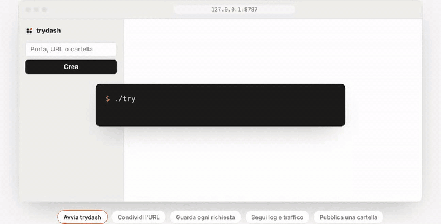
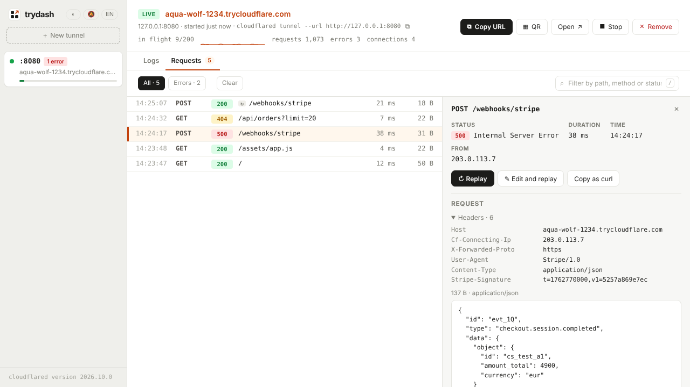

<p align="center">
  
</p>

<h1 align="center">trydash</h1>

<p align="center">
  Dashboard locale per i quick tunnel di <a href="https://developers.cloudflare.com/tunnel/get-started/quick-tunnels/">TryCloudflare</a>.<br>
  Esponi un servizio di sviluppo con un clic, tieni d’occhio tutti i tunnel e leggi i loro log in un posto solo.
</p>

<p align="center">
  <a href="README.md">English</a> · <b>Italiano</b> · <a href="https://mikzero.github.io/trydash/it/">Sito</a> · <a href="https://ko-fi.com/P8V12A631E">Sostieni su Ko-fi</a>
</p>

<p align="center">
  
</p>

---

## Perché

`cloudflared tunnel --url http://localhost:3000` è comodissimo, ma con due o tre servizi aperti ti ritrovi con più terminali da tenere d’occhio, URL da ricopiare e log difficili da leggere. trydash avvia e gestisce i quick tunnel al posto tuo:

- **più tunnel insieme**, ciascuno con stato (in avvio, attivo, fermato, terminato), URL e numero di errori;
- **un clic** per creare, fermare, riavviare o rimuovere un tunnel. Per crearne uno basta scrivere la porta: `3000` diventa `http://127.0.0.1:3000`;
- **una cartella online in un passo**: scrivi un percorso al posto della porta e trydash la serve, senza bisogno di un server locale;
- **ogni richiesta sotto gli occhi**: header e body di ciò che arriva al tuo servizio dal tunnel, da rimandare con un clic. Comodo per i webhook;
- **log leggibili**: livelli colorati, filtri, ricerca con evidenziazione, scorrimento continuo e modalità “segui la coda”;
- **i tunnel fermati restano consultabili**: puoi rileggerne i log e riavviarli. L’URL cambia a ogni avvio, ed è un limite dei quick tunnel;
- tema **chiaro e scuro**, layout per **mobile**, scorciatoie da tastiera, interfaccia in **italiano e inglese**.

## Funzioni

<p align="center">
  <picture>
    <source media="(prefers-color-scheme: dark)" srcset="site/images/screenshot-dark.png">
    
  </picture>
</p>

### Ispettore delle richieste

Ogni tunnel verso un’origine locale passa da un piccolo proxy che trydash avvia su `127.0.0.1`. `cloudflared` si collega al proxy invece che al tuo server, e il proxy inoltra ogni richiesta così com’è: stesso metodo, percorso, header e body, compresi gli upgrade WebSocket. Intanto ne tiene una copia, che compare nella scheda **Richieste** accanto ai log:

- l’elenco delle ultime 200 richieste, con ora, metodo, stato, percorso, durata e dimensione della risposta, dalla più recente;
- **Errori** per vedere solo le risposte `4xx` e `5xx` e le richieste fallite, e un filtro per percorso, metodo o stato;
- per ogni richiesta, header e body sia della richiesta sia della risposta. Il JSON è indentato, e i body `gzip`, `br` e `deflate` vengono decompressi per mostrarli;
- **Rimanda**, che manda di nuovo la stessa richiesta alla tua origine, per esempio il webhook di un pagamento dopo che hai corretto il codice. La nuova richiesta compare in cima con ↻ e il collegamento all’originale;
- **✎ Modifica e rimanda**, che apre prima la richiesta in un editor: metodo, percorso, header (uno per riga, `Nome: valore`) e body. La nuova richiesta compare con ↻✎. `Content-Length` viene ricalcolato; una firma calcolata sul body originale (Stripe, GitHub…) non vale più se lo cambi. Un body troppo grande per tenerlo si può riscrivere qui e mandare;
- **Copia come curl**, la stessa richiesta come comando `curl` verso l’origine locale. Gli header aggiunti da Cloudflare (`Cf-*`) restano fuori.

trydash tiene i primi 256 KB del body di ogni richiesta e i primi 64 KB di ogni risposta. Una richiesta con un body più grande viene mostrata tagliata e non si può rimandare. Tutto resta in memoria: **Svuota** cancella l’elenco, e rimuovere il tunnel lo elimina.

Se il tuo server non risponde, il proxy risponde `502`, scrive l’errore nei log e mostra il banner “non risponde”.

L’ispettore è attivo di default. Per spegnerlo togli la spunta da **Ispeziona richieste** in **Opzioni origine**. È spento anche per i tunnel Hello World e con un’origine HTTP/2, perché il proxy parla solo HTTP/1.1. Il comando `cloudflared` equivalente mostrato nell’intestazione resta quello che useresti senza trydash.

### Richieste salvate e Postman

**☆ Salva** nel dettaglio di una richiesta la mette nella scheda **Salvate**, con un nome che puoi cambiare. Da lì ne modifichi metodo, percorso, header e body, e **↻ Invia a questo tunnel** la manda all’origine del tunnel aperto. Compare nella scheda Richieste con ☆. Le richieste salvate restano tra un avvio e l’altro in `~/.config/trydash/requests.json`, accanto ai tunnel salvati e leggibile solo da te, perché possono contenere token e firme; con `--no-save` durano finché trydash resta aperto.

**Importa** accetta una collection Postman (v2.0 o v2.1), un file HAR o uno o più comandi `curl`, incollati o scelti come file. Le cartelle di Postman diventano nomi (`Ordini / Elenco`), le `{{variabili}}` vengono riempite dalla collection, l’autenticazione bearer, basic e API key diventa un header, e i body raw, form e GraphQL vengono importati. Gli script di Postman non vengono mai eseguiti e i campi file restano fuori; il risultato elenca cosa è stato saltato. **Esporta Postman** scarica le richieste salvate come collection Postman v2.1, con ogni URL su `{{baseUrl}}` impostato all’URL del tunnel. La scheda Richieste esporta le sue richieste come **Postman** o **HAR**, risposte comprese.

Una richiesta salvata o importata va sempre e solo all’origine di un tunnel: di `https://api.esempio.com/v1/ordini` trydash tiene `/v1/ordini`. trydash è un banco di prova per il tuo servizio, non un client HTTP verso host qualsiasi.

### Cartella statica

Scrivi il percorso di una cartella al posto della porta, per esempio `~/sito/dist`, `./build` o `C:\sito`, e premi **Crea**. trydash serve la cartella da solo, con un piccolo web server locale dedicato a quel tunnel, e `cloudflared` la pubblica. È il modo più rapido per condividere una build statica, un prototipo o qualche file.

- `/` e ogni sottocartella rispondono con il loro `index.html`. Una cartella che non ce l’ha mostra l’elenco dei file;
- il `Content-Type` giusto per pagine, stili, script, immagini, font, video e audio, con `ETag` e richieste `Range`, così nei video si può saltare avanti;
- **i file nascosti non vengono mai serviti**: un percorso con una parte che inizia con `.` (`.env`, `.git/`…) risponde `404` e non compare negli elenchi;
- niente fuori dalla cartella è raggiungibile, nemmeno con i link simbolici;
- solo `GET` e `HEAD`: gli altri metodi ricevono `405`.

`~` è la tua cartella home, e un percorso relativo parte dalla cartella da cui avvii trydash. Anche un nome senza `./`, come `site` o `site/dist`, è una cartella se lì ne esiste una con quel nome; altrimenti resta un nome di host, come prima (`site` → `http://site`). L’anteprima sotto il campo lo dice. La cartella deve esistere quando crei il tunnel, e non può essere la radice del disco o tutta la tua home. Le sue richieste compaiono sempre nella scheda **Richieste**, e nella sidebar si vedono 📁 e il nome della cartella. Le opzioni dell’origine non valgono per una cartella.

### Anteprima per il cliente

Per far vedere a un cliente un sito che è ancora sul tuo computer, come un WordPress in Docker, un’app Laravel o un server di sviluppo Vite, apri **Anteprima per il cliente** nel modulo, o **◎ Anteprima** nell’intestazione di un tunnel attivo. Le modifiche valgono dalla richiesta successiva e l’URL resta lo stesso.

- **Riscrivi gli URL di localhost.** Molti siti conoscono solo il loro indirizzo locale: WordPress rimanda i visitatori a `http://localhost:8080`, le pagine prendono stili e immagini da lì, Vite rifiuta un `Host` sconosciuto. Con questa opzione il proxy di trydash parla con l’origine usando l’`Host` del sito (lo impara dal primo redirect) e trasforma `http://localhost:8080`, `127.0.0.1:8080`, `ws://…` e le loro forme con `\/\/` o codificate negli URL nell’URL pubblico `https://`: in `Location`, `Link`, `Set-Cookie` (un `Domain=localhost` viene tolto), CSP e negli altri header, e in pagine, stili, script, JSON, XML e SVG fino a 8 MB, anche `gzip` e `br`. Al contrario, l’URL pubblico torna quello locale in `Origin`, `Referer`, nella query e nei piccoli corpi form o JSON, come il `redirect_to` di WordPress. Immagini, font, video e risposte `206` passano intatti. Nelle impostazioni e nel database di WordPress non cambia niente.
- **Nascondi ai motori di ricerca**, attivo di default: ogni risposta ha `X-Robots-Tag: noindex, nofollow`.
- **Etichetta «Anteprima»**: un piccolo badge in basso a sinistra nelle pagine HTML (“Preview” per chi legge in inglese). È markup aggiunto prima di `</body>`, quindi una CSP rigida può lasciarlo senza stile.
- **Percorsi bloccati**: i visitatori ricevono una pagina `403` “Non disponibile in questa anteprima” e l’origine non vede la richiesta. `/wp-admin` vale anche per `/wp-admin/…`; maiuscole, `//`, `..`, `%2e` e altre codifiche non lo aggirano. **WordPress**, **Laravel** e **Django** aggiungono i loro soliti percorsi riservati. La scheda **Richieste** mostra le richieste bloccate con ⛔, e **Rimanda** dalla dashboard arriva comunque all’origine.

Senza riscrittura trydash cerca i segnali tipici (un redirect a localhost, pagine che ci puntano, un server di sviluppo che rifiuta l’host pubblico) e mostra un banner con **Riscrivi gli URL locali**. La scheda **Richieste** mostra sempre quello che l’origine ha davvero mandato, prima della riscrittura.

Riscrittura, etichetta e percorsi bloccati vivono nel proxy dell’ispettore: accendono l’ispettore e non funzionano con un’origine HTTP/2. Un tunnel di una cartella accetta etichetta, noindex e percorsi bloccati. Da riga di comando: `trydash 8080 --rewrite --block /wp-admin,/wp-login.php --badge`.

### Scadenza

**Ferma dopo** nel modulo ferma il tunnel da solo dopo 30 minuti, 1, 2 o 8 ore, o un giorno, così un’anteprima per un cliente non resta online per dimenticanza. L’intestazione mostra il tempo rimasto (“⏱ si ferma tra 1 h 12 min”). Allo scadere il tunnel si ferma come con **Ferma**, i log scrivono “tunnel expired after 120 min” e la sidebar mostra “scaduto”. **Riavvia** fa ripartire il conto. Dalla riga di comando: `--expires 2h`; dall’API: `"expiresIn": 120`, in minuti, fino a una settimana.

### Tunnel salvati

trydash ricorda i tuoi tunnel tra un avvio e l’altro: origine o cartella e opzioni, mai log, richieste, URL o token. Al prossimo avvio tornano **fermi**, così niente torna pubblico finché non premi **Riavvia**. Ognuno riceve un URL nuovo, come sempre con i quick tunnel. Rimuovere un tunnel lo toglie anche dall’elenco.

L’elenco sta in `~/.config/trydash/tunnels.json` (`$XDG_CONFIG_HOME` se impostata, `%APPDATA%\trydash` su Windows), leggibile solo da te, perché può contenere le email autorizzate. `TRYDASH_CONFIG` sceglie un altro file, `TRYDASH_CONFIG=off` o `--no-save` spengono il salvataggio. `trydash 3000` riavvia il tunnel salvato verso la porta 3000 invece di aggiungerne un secondo. Un file rovinato viene rinominato `tunnels.json.broken` e non sovrascritto.

### Porte in ascolto

Sotto il campo, “in ascolto:” propone i server avviati sul tuo computer, come `:5173 · Vite` o `:8080 · php`: un clic riempie il campo. L’elenco viene dal sistema operativo (`/proc` su Linux, `lsof` su macOS, `netstat` su Windows) con il nome di ogni processo, quindi compaiono anche un WordPress in Docker su `8088` o un MAMP su `8888`, e ai server non arriva niente. Database, posta e servizi di sistema (`5432`, `3306`, `22`, AirPlay…) restano fuori, come le porte da 32768 in su, che editor e programmi di supporto scelgono a caso. Dove il sistema non lo dice, trydash prova le porte di sviluppo più comuni con una semplice connessione TCP. Un server in ascolto solo su IPv6 (`::1`) viene proposto come `http://[::1]:5173`, uno legato a un solo indirizzo (un bridge Docker, un IP di rete) con quell’indirizzo. Una porta già in un tunnel attivo appare sbiadita.

**⌕ Scansiona** fa un passo in più: chiede `GET /` una volta a ogni porta in ascolto, comprese quelle alte, e dice cosa risponde: WordPress, Vite, Next.js, Nuxt, SvelteKit, Astro, Angular, Laravel, Django, Rails, Flask, Express, Storybook, Jupyter, un PHP semplice, nginx o Apache, oppure il titolo della pagina. Trova anche un server che parla solo HTTPS, e il suo chip attiva **Non verificare TLS**. Scegliere un sito riconosciuto compila anche l’[anteprima per il cliente](#anteprima-per-il-cliente): **Riscrivi gli URL di localhost** per WordPress, Laravel, Django, Rails, Vite e gli altri server di sviluppo che controllano l’host, e i percorsi bloccati di WordPress, Laravel o Django. Quello che lo scan ha trovato resta sui chip finché lo stesso processo tiene la porta.

Da riga di comando, `trydash --scan` stampa lo stesso elenco con il comando per condividere ogni server:

```text
Listening on this computer:

  :5173   Vite · “My app” · node
          → trydash 5173 --rewrite
  :8080   WordPress · “Bottega Rossi” · php
          → trydash 8080 --rewrite --block /wp-admin,/wp-login.php,/xmlrpc.php
```

Nell’API è `GET /api/ports`, e `GET /api/ports?scan=1` per lo scan.

### QR code

**▦ QR** nell’intestazione mostra l’URL del tunnel come QR code: inquadralo con la fotocamera del telefono per provare il sito su mobile, o fallo inquadrare a un cliente. Il codice lo disegna trydash stesso (`public/js/qr.js`, senza dipendenze, verificato nei test contro un encoder di riferimento) e resta scuro su chiaro anche nel tema scuro, così ogni lettore lo legge. Si chiude con `Esc` e quando l’URL cambia.

### Notifiche

Il pulsante 🔕 nella sidebar attiva le notifiche del browser (prima il browser chiede il permesso). Mentre la scheda della dashboard è in secondo piano, trydash ti avvisa quando un tunnel ha il suo URL, quando il tuo server smette di rispondere (una volta per interruzione) e quando `cloudflared` termina o un tunnel scade. Un clic sulla notifica ti porta a quel tunnel. 🔔 le spegne. La scelta resta nel tuo browser.

### Accesso via email

Apri **Accesso via email** nel modulo di creazione e scrivi gli indirizzi autorizzati: `mario@cliente.it` per una persona, `*@azienda.it` per tutto un dominio. Si separano con virgola, punto e virgola, spazio o a capo. Va bene anche un elenco incollato da Outlook con i nomi (`Mario Rossi <mario@cliente.it>; …`): trydash tiene solo gli indirizzi. Al massimo 20 voci.

trydash avvia il tunnel con `--allowed-mail` e lo segna con 🔒 nella sidebar. Chi apre l’URL deve prima fare l’accesso con uno degli indirizzi autorizzati.

Gli ultimi indirizzi usati compaiono come suggerimenti cliccabili (“recenti”). Restano solo nel tuo browser (`localStorage`), mai sul server.

### Traffico

trydash avvia ogni tunnel con `--metrics` e ogni 2 secondi legge le metriche di `cloudflared`:

- **nella sidebar**, una barra delle richieste in corso rispetto al limite di 200: arancione da 150, rossa a 200;
- **nell’intestazione del tunnel**, le richieste in corso, il totale delle richieste, gli errori, le connessioni verso Cloudflare e un piccolo grafico degli ultimi 5 minuti.

Se le metriche non rispondono, i numeri diventano grigi con “dati non aggiornati”. Quando il tunnel è fermo restano i totali finali.

### Opzioni dell’origine

Sotto **Opzioni origine**:

- **Host header**, cioè `--http-host-header`, per i server che rispondono solo a un nome host preciso;
- **Non verificare TLS**, cioè `--no-tls-verify`, per un’origine https con un certificato self-signed;
- **Origine HTTP/2**, cioè `--http2-origin`. Spegne l’ispettore delle richieste;
- **Ispeziona richieste**, attivo di default: vedi [Ispettore delle richieste](#ispettore-delle-richieste).

Email e opzioni restano uguali quando riavvii il tunnel. L’anteprima sotto il campo mostra il comando `cloudflared` equivalente. Si può copiare così com’è: le voci con `*` sono già tra apici. Quando trydash gira su Windows, il comando usa doppi apici che funzionano sia in PowerShell sia in `cmd.exe`, con `$`, `` ` `` e `"` codificati come `%24`, `%60` e `%22`.

### Prova con Hello World

Il pulsante avvia `cloudflared tunnel --hello-world`, che serve una pagina di prova. Ti fa verificare che `cloudflared` e la rete funzionino anche senza un server locale.

### Avvertenze

| Quando | Cosa vedi |
|---|---|
| l’origine non risponde (negli ultimi 60 s) | banner “Il tuo server su :3000 non risponde — è avviato?” con **Riavvia** e **Prova con Hello World** |
| 150 o più richieste in corso | banner sul limite di 200: le richieste in più ricevono `429` |
| un redirect o link a localhost, o un server di sviluppo che rifiuta l’host pubblico | banner con **Riscrivi gli URL locali** |
| anteprima per il cliente attiva | etichette per URL riscritti, percorsi bloccati ed etichetta «Anteprima» |
| `--no-tls-verify` attivo | etichetta “Certificato dell’origine non verificato” e ⚠ nella sidebar |
| tunnel protetto | etichetta con gli indirizzi autorizzati e 🔒 nella sidebar |
| Riavvia | il primo clic mostra “Nuovo URL — conferma”: un quick tunnel riavviato cambia URL |
| sempre, nel modulo | “Solo per prove · niente SSE · nessuna garanzia di uptime” |

### Lingua

L’interfaccia e i messaggi d’errore sono in italiano o in inglese. trydash segue la lingua del browser, e un browser in qualsiasi altra lingua riceve l’inglese. Il pulsante **EN**/**IT** accanto al tema cambia lingua e ricorda la scelta nel browser (`localStorage`). Le risposte dell’API seguono l’header `Accept-Language`, in inglese se manca. Le righe che trydash aggiunge ai log (riavvii, uscite, un’origine che non risponde) sono in inglese, come quelle di `cloudflared`. I testi stanno in `public/js/i18n-it.js` e `public/js/i18n-en.js`.

## Installazione

Il modo più semplice è l’eseguibile già pronto: un unico file, senza Bun né altre dipendenze. Serve solo [`cloudflared`](https://developers.cloudflare.com/tunnel/downloads/) nel `PATH`. Se manca, la dashboard mostra i comandi per installarlo.

1. Dalla pagina **Releases** del repository scarica il file per il tuo sistema:

   | Sistema | File |
   |---|---|
   | Linux x64 | `trydash-<versione>-linux-x64` |
   | Linux ARM64 | `trydash-<versione>-linux-arm64` |
   | macOS Apple Silicon | `trydash-<versione>-darwin-arm64` |
   | macOS Intel | `trydash-<versione>-darwin-x64` |
   | Windows x64 | `trydash-<versione>-windows-x64.exe` |

2. Facoltativo: controlla il file con `SHA256SUMS`, pubblicato nella stessa release:

   ```sh
   sha256sum -c SHA256SUMS --ignore-missing
   ```

3. Avvialo:

   ```sh
   chmod +x trydash-2.0.0-linux-x64          # Linux e macOS
   xattr -d com.apple.quarantine trydash-2.0.0-darwin-arm64   # solo macOS, vedi sotto
   ./trydash-2.0.0-linux-x64
   ```

   Su Windows basta avviare il file `.exe`, da un terminale o con doppio clic.

`./trydash-… --version` stampa la versione. Le [variabili d’ambiente](#variabili-dambiente) sono le stesse dell’avvio da sorgente.

**macOS e Windows avvisano** perché i binari non sono firmati. Su macOS il comando `xattr` toglie il blocco di Gatekeeper sul file scaricato. Su Windows, se compare SmartScreen, scegli “Ulteriori informazioni” e poi “Esegui comunque”.

## Requisiti per lo sviluppo

- [Bun](https://bun.sh) ≥ 1.1 per avviare dai sorgenti. Il [workflow di release](.github/workflows/release.yml) installa Bun 1.4.4, e gli eseguibili lo incorporano.
- [`cloudflared`](https://developers.cloudflare.com/tunnel/downloads/) nel `PATH`

Nessuna dipendenza npm.

## Avvio da sorgente

```sh
git clone https://github.com/mikzero/trydash.git
cd trydash
bun start            # oppure: bun server.js
```

Avviato da un terminale, trydash apre la dashboard nel browser, già con il token. Altrimenti apri l’indirizzo stampato, di solito `http://127.0.0.1:8787/?token=…`. Scrivi la porta del tuo servizio, o il percorso di una cartella da pubblicare, e premi **Crea**.

Per avere il comando `trydash` ovunque, come negli esempi qui sotto, collegalo una volta dal repository:

```sh
bun link             # mette trydash in ~/.bun/bin
trydash --version    # trydash dev
```

Esegue il codice della copia locale, quindi `git pull` aggiorna anche lui; `bun unlink` lo toglie. Se la shell non lo trova, aggiungi `~/.bun/bin` al `PATH`. Con l’eseguibile scaricato, avvia quel file, oppure rinominalo `trydash` e mettilo in una cartella del `PATH`.

### Riga di comando

Con un argomento, trydash apre anche un tunnel all’avvio e ne stampa l’URL appena `cloudflared` lo ha. Comodo in uno script di `package.json`, come `"share": "trydash 5173"`.

```sh
trydash                          # solo la dashboard
trydash 3000                     # tunnel verso http://127.0.0.1:3000
trydash ./dist                   # pubblica una cartella
trydash 3000 --mail '*@azienda.it' --expires 2h
trydash https://localhost:8443 --no-tls-verify
```

| Opzione | A cosa serve |
|---|---|
| `-p`, `--port <n>` | porta della dashboard |
| `--open`, `--no-open` | apre la dashboard nel browser; di default solo quando trydash gira in un terminale |
| `--hello` | un tunnel Hello World |
| `--mail <elenco>` | accesso via email, come nel modulo |
| `--host-header <h>`, `--no-tls-verify`, `--http2-origin` | le opzioni dell’origine |
| `--no-inspect` | non registra le richieste |
| `--rewrite` · `--block <percorsi>` · `--badge` · `--index` | anteprima per il cliente: riscrive gli URL di localhost, `403` per quei percorsi, etichetta «Anteprima», lascia indicizzare ai motori di ricerca |
| `--no-save` | non salva né ripristina i tunnel |
| `--expires <tempo>` | ferma il tunnel dopo `30m`, `2h`, `1d`… |
| `--scan` | elenca i server web su questo computer, cosa sono e il comando per condividere ciascuno |
| `-v`, `--version` · `-h`, `--help` | versione · aiuto |

### Variabili d’ambiente

| Variabile | Default | A cosa serve |
|---|---|---|
| `TRYDASH_PORT` | `8787` | Porta della dashboard, che ascolta solo su `127.0.0.1`. `--port` ha la precedenza. |
| `TRYDASH_TOKEN` | casuale | Token di accesso della dashboard e dell’API. Di default trydash ne sceglie uno nuovo a ogni avvio e lo stampa nell’indirizzo. |
| `TRYDASH_OPEN` | — | Con `0` il browser non si apre mai. |
| `TRYDASH_CONFIG` | `~/.config/trydash/tunnels.json` | File dei [tunnel salvati](#tunnel-salvati); `off` spegne il salvataggio. |
| `TRYDASH_SEED` | — | Con `1` carica una sessione d’esempio dai log e dalle richieste in `test/fixtures/`. Utile per provare l’interfaccia senza aprire tunnel. |
| `TRYDASH_PROBE` | `auto` | `present` o `missing` simulano la presenza o l’assenza di `cloudflared`, senza eseguirlo. |
| `TRYDASH_PROBE_VERSION` | — | Testo della versione mostrato quando `TRYDASH_PROBE=present`. |

I nomi della 1.x funzionano ancora: `PORT`, e `DASHBOARD_SEED`, `DASHBOARD_PROBE` e `DASHBOARD_PROBE_VERSION`, che stampano un avviso.

Per provare la dashboard senza toccare la rete:

```sh
TRYDASH_SEED=1 TRYDASH_PROBE=present bun server.js
```

## Scorciatoie

| Tasto | Azione |
|---|---|
| `j` / `↓` | riga successiva |
| `k` / `↑` | riga precedente |
| `/` | cerca nei log, o filtra le richieste |
| `Esc` | svuota la ricerca, chiude il dettaglio o il menu |

Nella scheda **Richieste**, `j`/`k` passano da una richiesta all’altra.

## Cose da sapere sui quick tunnel

I quick tunnel sono pensati per **test e sviluppo**. Dalla [documentazione Cloudflare](https://developers.cloudflare.com/tunnel/get-started/quick-tunnels/):

- l’URL `*.trycloudflare.com` è casuale e **cambia a ogni avvio**;
- al massimo **200 richieste contemporanee** per tunnel; oltre, la risposta è `429`;
- i **Server-Sent Events** non sono supportati;
- **nessuna garanzia di uptime**. Per la produzione serve un Cloudflare Tunnel con nome.

## Sicurezza

- La dashboard ascolta solo su `127.0.0.1`, quindi non è raggiungibile da altre macchine.
- **L’API richiede un token**, così altri utenti e programmi sullo stesso computer non possono aprire tunnel né leggere le richieste ispezionate. trydash stampa all’avvio l’indirizzo con il token: aprirlo salva il token in un cookie `HttpOnly` e `SameSite=Strict` e lo toglie dalla barra degli indirizzi. Gli script lo mandano come `Authorization: Bearer <token>`. Senza token l’API risponde `401` e la pagina spiega cosa fare. Con `TRYDASH_TOKEN` il token resta fisso.
- HTTP/3 resta spento. trydash ascolta con `node:http` su TCP. Bun serve HTTP/3 solo da `Bun.serve`, con `http3` a true e un certificato TLS, e in quel caso le risposte annunciano `Alt-Svc`. `fetch()` e `Bun.serve()` lasciano HTTP/3 spento se il chiamante non lo chiede. Le build di release incorporano Bun 1.4.4. Quella release conta la dimensione degli header decodificati come dice RFC 9114 §4.2.2, per `Bun.serve({ http3: true })` e per `fetch` con `protocol: "http3"`. Il limite del server è `--max-http-header-size`, 16 KB di default, e una richiesta oltre quel limite riceve lo stato `431`. È la correzione del bug di amplificazione QPACK delle release Bun precedenti ([FoxIO, ottobre 2026](https://foxio.io/blog/header-accordions-qpack-amplification-attacks-against-http-3-servers)). La stessa release porta il decoder Brotli a 1.2.1, con la correzione di CVE-2026-111497. I binari di trydash 2.0.0 incorporano Bun 1.4.4 e hanno entrambe le correzioni; i binari 1.0.0 incorporano Bun 1.4.2 e non ne hanno nessuna, quindi non passare `http3: true` su un binario 1.0.0.
- Le altre pagine aperte nel browser non possono comandarla. Le richieste con un `Host` diverso da `127.0.0.1`/`localhost` vengono rifiutate, e questo blocca il DNS rebinding. Lo stesso vale per le richieste di modifica (`POST`, `DELETE`) con un `Origin` di un altro sito, e per ogni chiamata all’API, `GET` compresa, che il browser segna come proveniente da un’altra pagina (`Sec-Fetch-Site` diverso da `same-origin`), anche da un’altra porta di `127.0.0.1`. Gli script locali senza questi header, come `curl`, continuano a funzionare.
- La dashboard non si può mostrare dentro un’altra pagina (`frame-ancestors 'none'`, `X-Frame-Options: DENY`), così un altro sito non può farti cliccare i suoi pulsanti di nascosto. La sua `Content-Security-Policy` ammette solo i suoi script e i suoi stili.
- **Fermare un tunnel lo ferma davvero.** **Ferma** e **Rimuovi** mandano `SIGTERM` a `cloudflared`, e `SIGKILL` dopo 5 secondi se è ancora attivo. Dal primo clic il proxy locale del tunnel risponde `503` a tutto ciò che arriva ancora. Chiudendo trydash, si aspetta che i suoi processi `cloudflared` siano terminati.
- La memoria ha dei limiti: al massimo 50 tunnel, le ultime 20.000 righe di log per tunnel (le più vecchie se ne vanno), righe tagliate a 16 KB, e l’ispettore tiene 200 richieste con body limitati. Una raffica di controlli di `cloudflared` ne condivide uno solo.
- **Un tunnel rende pubblico il servizio che esponi**: chiunque abbia l’URL può raggiungerlo. Per limitarlo a persone precise usa l’accesso via email. Comunque non esporre servizi con dati reali o pannelli di amministrazione senza protezione.
- trydash non chiede né salva credenziali, token o account. I log e le richieste ispezionate restano in memoria e spariscono quando chiudi il server. Le richieste ispezionate possono contenere cookie e token mandati al tuo servizio: non lasciano mai il tuo computer, e **Svuota** le cancella.
- Il proxy dell’ispettore ascolta solo su `127.0.0.1`, su una porta casuale, e inoltra solo verso l’origine del suo tunnel.
- **I percorsi bloccati sono una cortesia, non una serratura.** Tengono clienti e crawler fuori da `/wp-admin` e simili, ma il resto del sito è pubblico quanto l’URL. Un vero accesso amministrativo ha comunque bisogno della sua password, oppure usa l’accesso via email.
- Un tunnel cartella rende pubblici tutti i file di quella cartella, tranne quelli nascosti. Scegli la cartella della build, non tutto il progetto o la tua home.
- Le origini con credenziali nell’URL (`http://user:pass@…`) vengono rifiutate.

## API

Il frontend usa una piccola API JSON, utile anche per script. Ogni chiamata richiede il token, per esempio `curl -H "Authorization: Bearer $TRYDASH_TOKEN" http://127.0.0.1:8787/api/state`:

| Metodo | Percorso | Descrizione |
|---|---|---|
| `GET` | `/api/state` | stato di `cloudflared` e di tutte le sessioni |
| `GET` | `/api/probe?fresh=1` | ricontrolla `cloudflared` |
| `GET` | `/api/ports` | i server in ascolto su questo computer, con `process`, e `busy` se un tunnel attivo li usa già; `?scan=1` chiede `GET /` a ciascuno e aggiunge `scan`: `{ "http", "kind", "label", "title", "tls", "suggest": { "rewrite", "preset" } }` |
| `POST` | `/api/sessions` | crea un tunnel, body `{ "origin": "3000", "options": { … } }` (vedi sotto) |
| `POST` | `/api/sessions/:id/stop` | ferma il tunnel |
| `PATCH` | `/api/sessions/:id/options` | cambia l’anteprima per il cliente di un tunnel, stesso URL: `{ "rewrite": true, "blocked": "/wp-admin", "badge": true, "noindex": true }` |
| `POST` | `/api/sessions/:id/restart` | riavvia un tunnel fermato o terminato |
| `DELETE` | `/api/sessions/:id` | ferma e rimuove la sessione |
| `GET` | `/api/sessions/:id/logs?offset=&limit=&levels=error,warn&q=testo` | pagina di log, filtrata (massimo 200 righe) |
| `GET` | `/api/sessions/:id/entries/:index` | una singola riga di log |
| `GET` | `/api/sessions/:id/requests?version=` | le richieste ispezionate, dalla più recente; con la `version` attuale la risposta è solo `{ "unchanged": true }` |
| `GET` | `/api/sessions/:id/requests/:seq` | una richiesta con header e body |
| `POST` | `/api/sessions/:id/requests/:seq/replay` | rimanda la richiesta all’origine; restituisce quella nuova. Un body facoltativo `{ "method", "path", "headers": [["Nome", "valore"]], "body" }` la modifica prima |
| `DELETE` | `/api/sessions/:id/requests` | svuota l’elenco |
| `GET` | `/api/sessions/:id/requests/export?format=postman\|har` | le richieste del tunnel da scaricare |
| `GET` | `/api/collection` | le richieste salvate |
| `POST` | `/api/collection` | ne salva una: `{ "request": { "name", "method", "path", "headers", "body" } }`, oppure `{ "session": "s1", "seq": 3 }` per una catturata |
| `POST` | `/api/collection/import` | `{ "text": "…" }`: Postman, HAR o curl; restituisce quante ne ha aggiunte e gli avvisi |
| `GET` | `/api/collection/export?format=postman&session=s1` | le richieste salvate come collection Postman |
| `GET`, `PATCH`, `DELETE` | `/api/collection/:id` | una richiesta salvata: leggi, modifica, elimina |
| `POST` | `/api/collection/:id/send` | `{ "session": "s1" }`: la manda all’origine di quel tunnel |

`options` è facoltativo:

```json
{
  "mode": "origin",
  "allowedMail": "mario@cliente.it, *@azienda.it",
  "hostHeader": "app.local",
  "noTlsVerify": false,
  "http2Origin": false,
  "inspect": true,
  "expiresIn": 120,
  "rewrite": false,
  "blocked": ["/wp-admin", "/wp-login.php"],
  "badge": false,
  "noindex": true
}
```

Con `"mode": "hello"` l’origine viene ignorata e il tunnel serve la pagina Hello World. Con `"mode": "folder"` e `"folder": "~/sito"` il tunnel serve quella cartella: se la cartella non esiste la risposta è `400` con la chiave `folder.notFound`, e per la radice del disco o la home `folder.tooBroad`. Ogni sessione ha anche `equivalentWindows`, il comando con gli apici per Windows. Oltre 50 tunnel la risposta è `429` con `session.tooMany`. Ogni sessione in `/api/state` ha un campo `inspect`: `{ "enabled": true, "count": 12, "total": 40, "version": 85, "target": "http://127.0.0.1:41733" }`, oppure `{ "enabled": false, "reason": "hello" | "http2" | "off" }`. Gli endpoint delle richieste rispondono `409` con la chiave `inspect.disabled` quando l’ispettore è spento. Le risposte d’errore hanno la forma `{ "error": "…", "key": "options.mailInvalid", "params": { … } }`.

## Build locale

```sh
bun run build                                 # eseguibile per il sistema corrente, in dist/
bun run build -- --all --version 2.0.0        # tutti e 5 i sistemi
bun run build -- --target bun-linux-arm64     # un sistema preciso
```

La build genera `build/entry.js`, che incorpora tutti i file di `public/`, e lo compila con `bun build --compile`. In `dist/` finiscono gli eseguibili e `SHA256SUMS`. Ogni eseguibile pesa circa 85 MB, perché contiene il runtime di Bun. `build/` e `dist/` sono ignorate da git.

## Rilasciare una versione

Le release partono da un **tag git**. Il workflow `.github/workflows/release.yml` si attiva sui tag che iniziano con `v` ed esegue, nell’ordine:

1. i test (`bun test`);
2. la build dei 5 eseguibili, con la versione presa dal tag;
3. uno smoke test dell’eseguibile Linux: `--version`, avvio, risposta di `/` e `/api/state`;
4. la pubblicazione della Release su GitHub, con eseguibili, `SHA256SUMS` e il **messaggio del tag come note**.

Se un passo fallisce, la release non viene creata.

```sh
git checkout main && git pull
bun test                                          # verifica locale
bun scripts/release-notes.js v1.1.0               # bozza in release-notes.md
# rileggi e ritocca release-notes.md
git tag -a v1.1.0 -F release-notes.md --cleanup=verbatim
git push origin v1.1.0                            # avvia il workflow
```

Segui l’avanzamento in **Actions** su GitHub, oppure con `gh run watch`.

Quando la release è pubblicata, porta i link diretti del sito alla nuova versione e fai push su `main`: la pagina si ripubblica da sola. Un test controlla che tutti i link usino la stessa versione.

```sh
sed -i 's/1\.0\.0/1.1.0/g' site/index.html site/it/index.html   # vecchia → nuova versione
bun test test/site.test.js
```

### Le note della release (messaggio del tag)

Il messaggio del tag annotato diventa il testo della Release. È Markdown e si scrive **in inglese**, come il sito principale:

```markdown
trydash 1.1.0                      ← prima riga: titolo della Release

One or two sentences on what this version brings.

## ⚠️ Breaking changes             ← solo se ce ne sono (versione MAGGIORE)
- …

## ✨ New
- **ui**: …

## 🐛 Fixes
- **server**: …

## 🔒 Security                      ← facoltativa
- …

## 🧰 Maintenance                   ← ci, docs, test, refactor
- …
```

GitHub aggiunge in fondo il link **Full Changelog** con il confronto rispetto alla versione precedente.

`scripts/release-notes.js` prepara la bozza dai commit successivi all’ultimo tag. Si basa su [Conventional Commits](https://www.conventionalcommits.org/it/), lo stile dei messaggi di commit del progetto:

| Commit | Sezione |
|---|---|
| `feat(ui): …` | New |
| `fix(server): …` | Fixes |
| `feat!: …` | Breaking changes |
| `ci:`, `docs:`, `test:`, `refactor:`, altri | Maintenance |

La bozza è un punto di partenza. Riscrivi le voci in inglese per chi usa trydash, non per chi legge il codice, e aggiungi la sezione Security quando serve.

Due avvertenze sul comando `git tag`:
- **`--cleanup=verbatim` è necessario.** Senza, git tratta le righe che iniziano con `#` come commenti e cancella i titoli Markdown.
- **Un tag senza messaggio** (`git tag v1.1.0`) pubblica comunque la Release, ma solo con le note automatiche di GitHub.

Per vedere il messaggio di un tag: `git tag -l --format='%(contents)' v1.0.0`.

### Come scegliere il numero di versione

I tag seguono il [versionamento semantico](https://semver.org/lang/it/), `vMAGGIORE.MINORE.PATCH`:

| Cambia | Quando | Esempio |
|---|---|---|
| **PATCH** | correzioni che non cambiano il comportamento previsto | `v1.0.0` → `v1.0.1` |
| **MINORE** | funzioni nuove compatibili con le precedenti | `v1.0.1` → `v1.1.0` |
| **MAGGIORE** | cambiamenti incompatibili (API, variabili d’ambiente, comportamento) | `v1.4.2` → `v2.0.0` |

- **Pre-release:** un tag con un trattino, come `v1.1.0-rc.1` o `v2.0.0-beta.2`, crea una release segnata come *pre-release*, che GitHub non mostra come “ultima versione”. Serve a provare una versione prima di pubblicarla davvero.
- **Tag annotati** (`git tag -a`): registrano autore, data e messaggio. Sono quelli giusti per le release.
- **Tagga solo `main`**, dopo che i test sono verdi.
- **Non spostare né riusare un tag già pubblicato.** Chi ha scaricato `v1.0.0` deve poter contare sul fatto che resti identica. Se una release ha un errore, pubblica la successiva (`v1.0.1`). Se il workflow è fallito prima di pubblicare, puoi cancellare il tag (`git push origin :refs/tags/v1.0.0` e `git tag -d v1.0.0`), correggere e ricrearlo.
- **Elenco delle versioni:** `git tag --sort=-v:refname`, oppure `gh release list`.

## Sito

La landing page sta in `site/`: HTML, CSS e JavaScript statici, senza build. È in due lingue: inglese in `site/index.html`, la pagina principale, e italiano in `site/it/index.html`. I testi scritti dagli script stanno in `site/i18n.js`. Un browser in italiano che arriva sulla pagina inglese viene portato su quella italiana, a meno che il visitatore non abbia già scelto una lingua dal selettore EN/IT. Un test controlla che le due pagine abbiano la stessa struttura. Il workflow `.github/workflows/pages.yml` la pubblica su GitHub Pages a ogni push su `main` che la tocca. Per vederla basta aprire `site/index.html` nel browser.

Inari Bash, la volpina nell’angolo, sta in `site/mascot.js`. Dice una frase per sezione (`data-mascot`) e per alcune ha un umore (`data-mascot-mood`: `party` lancia coriandoli, `wave` saluta). Si inclina con lo scorrimento e verso il puntatore, si dimena con dei cuoricini quando la tocchi, e si appisola dopo 25 secondi senza scorrere. È un’unica immagine su livelli sovrapposti (`.fox-lean`, `.fox`, `.volpina` in `site/site.css`), e con “riduci movimento” resta solo il fumetto.

`site/images/logo.svg`, `site/favicon.svg` e `site/favicon.png` sono copie di quelli in `public/`: un test controlla che restino uguali.

I link di download sono link diretti ai file della release, scritti in `site/index.html`, e funzionano anche senza JavaScript. Il pulsante principale propone il file per il sistema di chi visita. Se l’API di GitHub segnala una release più recente, la pagina aggiorna da sola i link.

## Struttura

```
server.js            server HTTP e API (Bun, solo moduli node:*)
src/assets.js        lettura dei file del progetto (dal disco o incorporati nel binario)
src/runtime.js       avvio/arresto di cloudflared e lettura dello stream
src/cli.js           riga di comando, variabili TRYDASH_*, apertura del browser
src/config.js        tunnel salvati (~/.config/trydash/tunnels.json)
src/ports.js         server di sviluppo in ascolto su questo computer
src/collection.js    richieste salvate (~/.config/trydash/requests.json)
src/formats.js       import ed export Postman, HAR e curl
src/traffic.js       lettura periodica delle metriche di cloudflared
src/inspector.js     ispettore delle richieste: proxy locale, richieste registrate, replay
src/static.js        file di un tunnel cartella
src/load-dashboard.js carica le librerie condivise nel server
scripts/build.js     build degli eseguibili autonomi
scripts/release-notes.js bozza delle note di release dai commit
site/                landing page (GitHub Pages) in inglese, site/it/ in italiano
.github/workflows/   release automatica sui tag v* e pubblicazione del sito
public/js/           librerie condivise (parse, sessions, window, i18n…) e interfaccia:
                     requests.js la scheda Richieste, saved.js la scheda Salvate, qr.js i QR code, notify.js le notifiche
public/css/app.css   tema "Paper" chiaro/scuro
test/                test con bun test
```

## Test

```sh
bun test
```

I test usano processi finti e non avviano mai `cloudflared`. Il test della build compila un eseguibile per il sistema corrente e lo avvia da un’altra cartella: ci vogliono un paio di secondi.

```sh
npm run test:e2e
```

Una verifica end-to-end facoltativa dell’anteprima per il cliente, su macOS e Linux. Servono Playwright con Chromium (`npm i -D playwright && npx playwright install chromium`) e `openssl`. trydash parte da riga di comando con un `cloudflared` finto, dei sostituti di WordPress, Vite e Laravel girano sulle porte 18090, 15173 e 18000, e un server HTTPS locale fa la parte dell’edge di Cloudflare: un Chromium vero apre `https://….trycloudflare.com` come farebbe un cliente, con redirect, cookie, login, gzip, API REST, WebSocket di Vite, percorsi bloccati ed etichetta. Ogni richiesta del client verso `localhost` conta come errore. Gli screenshot finiscono in una cartella temporanea, o in `E2E_SHOTS`.

## Sostieni il progetto

trydash è gratuito e lo sviluppo nel tempo libero. Se ti fa risparmiare tempo, puoi offrirmi un caffè su Ko-fi:

[](https://ko-fi.com/P8V12A631E)

Lo stesso link sta dietro il pulsante **Sponsor** su GitHub, nel footer del sito e in fondo alla sidebar della dashboard.

## Licenza

trydash è software libero, distribuito con licenza [GNU GPL v3.0 o successiva](LICENSE).

---

trydash è un progetto indipendente e non è affiliato a Cloudflare. “Cloudflare” e “TryCloudflare” sono marchi dei rispettivi proprietari.
