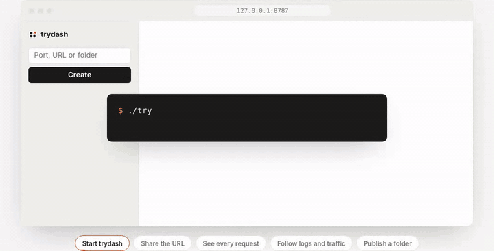
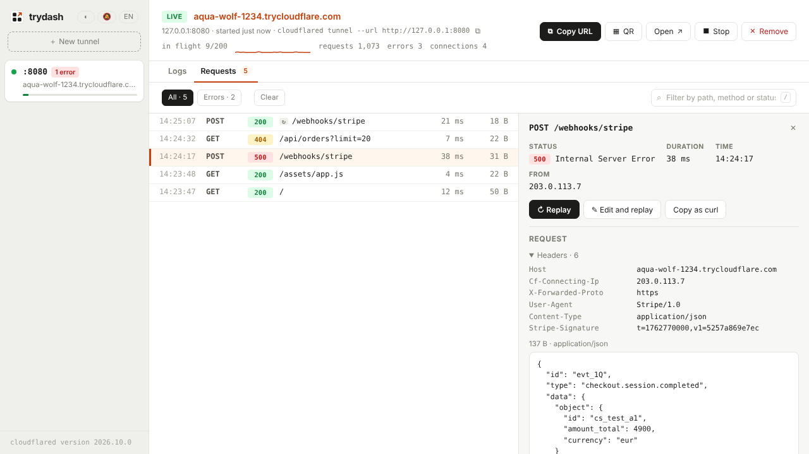

<p align="center">
  
</p>

<h1 align="center">trydash</h1>

<p align="center">
  A local dashboard for <a href="https://developers.cloudflare.com/tunnel/get-started/quick-tunnels/">TryCloudflare</a> quick tunnels.<br>
  Expose a dev service in one click, keep an eye on every tunnel and read their logs in one place.
</p>

<p align="center">
  <b>English</b> · <a href="README.it.md">Italiano</a> · <a href="https://mikzero.github.io/trydash/">Website</a> · <a href="https://ko-fi.com/P8V12A631E">Support on Ko-fi</a>
</p>

<p align="center">
  
</p>

---

## Why

`cloudflared tunnel --url http://localhost:3000` is great, but with two or three services running you end up with several terminals to watch, URLs to copy around and logs that are hard to read. trydash starts and manages quick tunnels for you:

- **many tunnels at once**, each with its status (starting, live, stopped, exited), URL and error count;
- **one click** to create, stop, restart or remove a tunnel. To create one, just type the port: `3000` becomes `http://127.0.0.1:3000`;
- **a folder online in one step**: type a path instead of a port and trydash serves it, no local server needed;
- **every request in view**: headers and bodies of what reaches your service through the tunnel, with one-click replay. Handy for webhooks;
- **readable logs**: colored levels, filters, highlighted search, infinite scrolling and a “follow the tail” mode;
- **stopped tunnels stay readable**: you can go back to their logs and restart them. The URL changes on every start, which is a limit of quick tunnels;
- **light and dark** themes, a **mobile** layout, keyboard shortcuts, an interface in **English and Italian**.

The interface is in English and Italian: it follows your browser, and the **EN**/**IT** button in the sidebar switches it (see [Language](#language)).

## Features

<p align="center">
  <picture>
    <source media="(prefers-color-scheme: dark)" srcset="site/images/screenshot-dark.png">
    
  </picture>
</p>

### Request inspector

Every tunnel to a local origin goes through a small proxy that trydash runs on `127.0.0.1`. `cloudflared` connects to it instead of your server, and it forwards each request unchanged: same method, path, headers and body, WebSocket upgrades included. On the way it keeps a copy, which the **Requests** tab next to the logs shows:

- the list of the latest 200 requests, with time, method, status, path, duration and response size, newest first;
- **Errors** for `4xx`, `5xx` and failed requests only, and a filter by path, method or status;
- for each request, the headers and the body of both the request and the response. JSON is indented, and `gzip`, `br` and `deflate` bodies are decompressed for display;
- **Replay**, which sends the same request to your origin again, for example a payment webhook after you fix the handler. The new request appears at the top with ↻ and a link to the original;
- **✎ Edit and replay**, which opens the request in an editor first: method, path, headers (one `Name: value` per line) and body. The new request shows ↻✎. `Content-Length` is computed again; a signature made on the original body (Stripe, GitHub…) no longer matches once you change it. A body too large to keep can be written anew here and sent;
- **Copy as curl**, the same request as a `curl` command against your local origin. The headers Cloudflare adds (`Cf-*`) are left out.

trydash keeps the first 256 KB of each request body and the first 64 KB of each response body. A request with a larger body is shown cut and can’t be replayed. Everything stays in memory: **Clear** empties the list, and removing the tunnel deletes it.

When your server doesn’t answer, the proxy replies `502`, writes the error in the logs and shows the “server not responding” banner.

The inspector is on by default. To turn it off, clear **Inspect requests** under **Origin options**. It’s also off for Hello World tunnels and with an HTTP/2 origin, because the proxy speaks HTTP/1.1 only. The equivalent `cloudflared` command shown in the header stays the one you would run without trydash.

### Saved requests and Postman

**☆ Save** in a request's details keeps it in the **Saved** tab, with a name you can change. From there you edit method, path, headers and body, and **↻ Send to this tunnel** sends it to the origin of the tunnel on screen. It shows up in the Requests tab with ☆. Saved requests stay between runs in `~/.config/trydash/requests.json`, next to the saved tunnels and readable only by you, because they can contain tokens and signatures; with `--no-save` they last until trydash closes.

**Import** takes a Postman collection (v2.0 or v2.1), a HAR file or one or more `curl` commands, pasted or picked as a file. Postman folders become names (`Orders / List`), `{{variables}}` are filled in from the collection, bearer, basic and API key auth become headers, and raw, form and GraphQL bodies come along. Postman scripts are never run, and file fields are left out; the result lists what was skipped. **Export Postman** downloads the saved requests as a Postman v2.1 collection, with every URL on `{{baseUrl}}` set to the tunnel URL. The Requests tab exports its requests as **Postman** or **HAR**, responses included.

A saved or imported request only ever goes to the origin of a tunnel: of `https://api.example.com/v1/orders` trydash keeps `/v1/orders`. trydash is a test bench for your own service, not an HTTP client for any host.

### Static folder

Type the path of a folder instead of a port, for example `~/site/dist`, `./build` or `C:\site`, and press **Create**. trydash serves the folder itself, on a local web server for that tunnel only, and `cloudflared` publishes it. It’s the quickest way to share a static build, a prototype or a few files.

- `/` and every subfolder answer with their `index.html`. A folder without one shows the list of its files;
- the right `Content-Type` for pages, styles, scripts, images, fonts, video and audio, with `ETag` and `Range` requests, so videos can be seeked;
- **hidden files are never served**: a path with a part that starts with `.` (`.env`, `.git/`…) answers `404` and doesn’t appear in lists;
- nothing outside the folder is reachable, symbolic links included;
- only `GET` and `HEAD`: other methods get `405`.

`~` is your home folder, and a relative path starts from the folder trydash runs in. A name without `./`, like `site` or `site/dist`, is a folder too when one with that name exists there; otherwise it's a host name, as before (`site` → `http://site`). The preview under the field says which. The folder must exist when you create the tunnel, and it can’t be the root of the disk or your whole home folder. Its requests always appear in the **Requests** tab, and the sidebar shows 📁 and the folder name. The origin options don’t apply to a folder.

### Client preview

To show a client a site that is still on your computer, like a WordPress in Docker, a Laravel app or a Vite dev server, open **Client preview** in the form, or **◎ Preview** in the header of a running tunnel. The changes apply from the next request and the URL stays the same.

- **Rewrite localhost URLs.** Many sites know only their local address: WordPress sends visitors to `http://localhost:8080`, pages link styles and images there, Vite refuses an unknown `Host`. With this on, trydash's proxy talks to the origin with the site's own `Host` (learned from its first redirect) and turns `http://localhost:8080`, `127.0.0.1:8080`, `ws://…` and their `\/\/`-escaped and URL-encoded forms into the public `https://` URL: in `Location`, `Link`, `Set-Cookie` (a `Domain=localhost` is dropped), CSP and other headers, and in pages, styles, scripts, JSON, XML and SVG up to 8 MB, `gzip` and `br` included. The other way round, the public URL becomes the local one again in `Origin`, `Referer`, the query string and small form or JSON bodies, like WordPress' `redirect_to`. Images, fonts, video and `206` answers pass untouched. Nothing changes in WordPress' settings or database.
- **Hide from search engines**, on by default: every answer gets `X-Robots-Tag: noindex, nofollow`.
- **“Preview” label**: a small badge at the bottom left of HTML pages (“Anteprima” for visitors who read Italian). It's markup added before `</body>`, so a strict CSP can leave it unstyled.
- **Blocked paths**: visitors get a `403` “Not available in this preview” page, and the origin never sees the request. `/wp-admin` also covers `/wp-admin/…`; case, `//`, `..`, `%2e` and other encodings don't get around it. **WordPress**, **Laravel** and **Django** add their usual private paths. The **Requests** tab shows blocked requests with ⛔, and **Replay** from the dashboard still reaches the origin.

Without rewriting, trydash watches for the usual signs (a redirect to localhost, pages that link to it, a dev server refusing the public host) and shows a banner with **Rewrite local URLs**. The **Requests** tab always shows what the origin really sent, before rewriting.

Rewriting, the label and blocked paths live in the inspector's proxy, so they turn the inspector on and don't work with an HTTP/2 origin. A folder tunnel takes the label, noindex and blocked paths. On the command line: `trydash 8080 --rewrite --block /wp-admin,/wp-login.php --badge`.

### Personal links

The **Clients** tab makes one link per client, like `https://….trycloudflare.com/?tdk=…`. Each card shows whether the client opened it, how many pages they viewed and when they last came; the dashboard tells you the first time (“Mario opened the preview”), and the **Requests** tab marks every request with the client's name.

- The key leaves the address bar at once: trydash's proxy swaps it for an `HttpOnly`, `Secure` cookie and redirects to the clean URL. Neither the key nor the cookie reaches your site, so its own cookies and logins work as usual.
- A link can ask for a **PIN** of 6 to 8 digits. Only a hash of it is kept. Five wrong tries from the same visitor lock that visitor for ten minutes; someone else can still enter.
- **Revoke** stops a link at its next page, **Restore** brings it back, **Delete** removes it for good. Changing the PIN logs out whoever entered with the old one.
- **Personal links only** (`--links-only`) refuses anyone who opens the URL without a link. The dashboard's **Open** button always gets in.
- Links are saved with the tunnel and keep their keys: after a restart the URL changes, and the **Copy link** of the same card gives the new one with the same key.

### Client comments

With **Client comments on the page** (in Client preview, in the Comments tab, or `--comments`), every HTML page gets a **💬 Comment** button. The client presses it, clicks the spot they mean (a click there doesn't follow links) and writes. trydash picks the smallest element under the click, so a transparent link over a card doesn't hide its title; ▲ and ▼ in the box choose a bigger or smaller one. While commenting, the button steps aside and the bar on top, with **Cancel**, moves to the bottom when the pointer rests on what it covers. Clicking their own pin later, the client can **Edit** or **Delete** it: with a personal link from any browser, without one from the same browser. Back in the **Comments** tab you find:

- the text, who wrote it (the name of their personal link, or the one they typed), when;
- the page and its title, with **open on the page**, which highlights the pin;
- the element (`<h1> “About us”`), the screen size, the browser, and the JavaScript errors the page had: often they are the real issue;
- a **screenshot** of the page as the client saw it: their screen size, the pin, the comment's bubble open, in their language. trydash takes it with the Chrome, Chromium, Edge or Brave already on your computer, headless and with a throwaway profile (your own is never touched); `TRYDASH_CHROME` points to another one. Screenshots are kept next to the saved tunnels, in `shots/`, and go with their comment. Without one of those browsers the card says so;
- the page **on your machine** first (that's where you fix it), and **public, with pin** to see it as the client;
- **Resolve** (the pin leaves the client's page), **Copy** as Markdown for an issue, **Delete**, and **Copy as Markdown** for all of them.

The widget is a script trydash serves from `/__trydash/comments.js`, inside a shadow root, so it works with a strict `Content-Security-Policy` and the site's styles don't touch it. Comments go to trydash, never to your site. A client with a personal link sees only their own pins; visitors without one see the anonymous ones. They are saved with the tunnel: at most 500, 30 per visitor every ten minutes.

### Webhook queue

**Queue webhooks while the server is down** (in Origin options, in the Requests tab, or `--queue`) covers the moment your server restarts, crashes or waits for a build while the tunnel stays up. A `POST`, `PUT`, `PATCH` or `DELETE` that finds it down gets `202 Accepted` and waits in trydash with its exact body and headers, so a Stripe or GitHub signature still matches. As soon as the port answers again, trydash delivers the queue in order. The Requests tab marks them *queued*, `→ #12` once delivered, *from queue* on the delivery, and a banner offers **Deliver now** and **Empty the queue**.

It doesn't help when the tunnel itself stops: trydash closed, the computer off or offline. The request then never reaches trydash, and a restarted quick tunnel has a new URL. Stripe and GitHub keep their own history of deliveries, to send them again once you update the URL.

### Expiry

**Stop after** in the form stops the tunnel by itself after 30 minutes, 1, 2 or 8 hours, or a day, so a preview for a client doesn’t stay online by mistake. The header shows the time left (“⏱ stops in 1 h 12 min”). When it’s up, the tunnel stops like with **Stop**, the logs say “tunnel expired after 120 min”, and the sidebar shows “expired”. **Restart** starts the clock again. From the command line: `--expires 2h`; from the API: `"expiresIn": 120`, in minutes, up to a week.

### Saved tunnels

trydash remembers your tunnels between runs: origin or folder and options, never logs, requests, URLs or tokens. At the next start they come back **stopped**, so nothing turns public again until you press **Restart**. Each one gets a new URL, as quick tunnels always do. Removing a tunnel removes it from the list too.

The list lives in `~/.config/trydash/tunnels.json` (`$XDG_CONFIG_HOME` if set, `%APPDATA%\trydash` on Windows), readable only by you, because it can contain the allowed emails. `TRYDASH_CONFIG` picks another file, `TRYDASH_CONFIG=off` or `--no-save` turns saving off. `trydash 3000` restarts the saved tunnel to port 3000 instead of adding a second one. A broken file is renamed to `tunnels.json.broken` and not overwritten.

### Listening ports

Under the field, “listening:” suggests the servers running on your computer, like `:5173 · Vite` or `:8080 · php`: a click fills the field. The list comes from the operating system (`/proc` on Linux, `lsof` on macOS, `netstat` on Windows) with the name of each process, so a WordPress in Docker on `8088` or a MAMP on `8888` shows up too, and nothing is sent to the servers. Databases, mail and system services (`5432`, `3306`, `22`, AirPlay…) are left out, and so are ports from 32768 up, which editors and helpers pick at random. Where the system won't say, trydash tries the usual development ports with a plain TCP connection. A server listening only on IPv6 (`::1`) is suggested as `http://[::1]:5173`, one bound to a single address (a Docker bridge, a LAN IP) with that address. A port already in a live tunnel is shown faded. With many ports open, the likeliest five stay as chips (recognized by a scan, the usual dev ports, dev processes such as `node`, `php` or `docker-proxy`) and **+N more** opens the others in a list you can filter by port, process or kind.

**⌕ Scan** goes one step further: it asks every listening port `GET /` once, high ports included, and tells what answers: WordPress, Vite, Next.js, Nuxt, SvelteKit, Astro, Angular, Laravel, Django, Rails, Flask, Express, Storybook, Jupyter, a plain PHP, nginx or Apache, or the page title. A server that speaks only HTTPS is found too, and its chip turns on **Don’t verify TLS**. Picking a recognized site also fills the [client preview](#client-preview): **Rewrite localhost URLs** for WordPress, Laravel, Django, Rails, Vite and the other dev servers that check the host, and the blocked paths of WordPress, Laravel or Django. The findings stay on the chips while the same process holds the port.

From the command line, `trydash --scan` prints the same list with the command to share each server:

```text
Listening on this computer:

  :5173   Vite · “My app” · node
          → trydash 5173 --rewrite
  :8080   WordPress · “Bottega Rossi” · php
          → trydash 8080 --rewrite --block /wp-admin,/wp-login.php,/xmlrpc.php
```

The API has it as `GET /api/ports`, and `GET /api/ports?scan=1` for the scan.

### QR code

**▦ QR** in the header shows the tunnel URL as a QR code: point your phone’s camera at it to try the site on mobile, or let a client scan it. The code is drawn by trydash itself (`public/js/qr.js`, no dependencies, checked against a reference encoder in the tests) and stays dark on light in the dark theme too, so every scanner reads it. It closes with `Esc` and when the URL changes.

### Notifications

The 🔕 button in the sidebar turns on browser notifications (the browser asks first). While the dashboard tab is in the background, trydash tells you when a tunnel has its URL, when your server stops answering (once per outage) and when `cloudflared` exits or a tunnel expires. A click on the notification brings you to that tunnel. 🔔 turns them off. The choice stays in your browser.

### Email access

Open **Email access** in the create form and type the allowed addresses: `mario@client.com` for one person, `*@company.com` for a whole domain. Separate them with commas, semicolons, spaces or new lines. A list pasted from Outlook with names (`Mario Rossi <mario@client.com>; …`) works too: trydash keeps only the addresses. At most 20 entries.

trydash starts the tunnel with `--allowed-mail` and marks it with 🔒 in the sidebar. Whoever opens the URL must first sign in with one of the allowed addresses.

The last addresses you used show up as clickable suggestions (“recent”). They stay in your browser only (`localStorage`), never on the server.

### Traffic

trydash starts every tunnel with `--metrics` and reads the `cloudflared` metrics every 2 seconds:

- **in the sidebar**, a bar of the requests in flight against the 200 limit: orange from 150, red at 200;
- **in the tunnel header**, the requests in flight, the total requests, errors, connections to Cloudflare and a small chart of the last 5 minutes.

If the metrics stop answering, the numbers turn grey with “data not up to date”. When the tunnel is stopped, the final totals stay.

### Origin options

Under **Origin options**:

- **Host header**, that is `--http-host-header`, for servers that only answer to a specific host name;
- **Don’t verify TLS**, that is `--no-tls-verify`, for an https origin with a self-signed certificate;
- **HTTP/2 origin**, that is `--http2-origin`. It turns the request inspector off;
- **Inspect requests**, on by default: see [Request inspector](#request-inspector).

Email and options stay the same when you restart the tunnel. The preview under the field shows the equivalent `cloudflared` command. You can copy it as is: entries with `*` are already quoted. When trydash runs on Windows, the command uses double quotes that work in both PowerShell and `cmd.exe`, with `$`, `` ` `` and `"` percent-encoded.

### Try with Hello World

The **Try with Hello World** button runs `cloudflared tunnel --hello-world`, which serves a test page. It lets you check that `cloudflared` and the network work, even without a local server.

### Warnings

| When | What you see |
|---|---|
| the origin doesn’t answer (in the last 60 s) | a “Your server on :3000 isn’t responding — is it running?” banner with **Restart** and **Try with Hello World** |
| 150 or more requests in flight | a banner about the 200 limit: extra requests get `429` |
| a redirect or links to localhost, or a dev server refusing the public host | a banner with **Rewrite local URLs** |
| client preview on | labels for rewritten URLs, blocked paths and the “Preview” label |
| requests queued while the server is down | a banner with **Deliver now** and **Empty the queue** |
| a client opens their personal link, or leaves a comment | a notice in the dashboard (and from the browser, with notifications on) |
| `--no-tls-verify` on | an “Origin certificate not verified” label and ⚠ in the sidebar |
| protected tunnel | a label with the allowed addresses and 🔒 in the sidebar |
| Restart | the first click shows “New URL — confirm”: a restarted quick tunnel changes URL |
| always, in the form | “Testing only · no SSE · no uptime guarantee” |

### Language

The interface and the error messages are in English or Italian. trydash follows the browser language, and a browser in any other language gets English. The **EN**/**IT** button next to the theme switches language and remembers the choice in the browser (`localStorage`). API responses follow the `Accept-Language` header, with English when it’s missing. The lines trydash adds to the logs (restarts, exits, an origin that doesn’t answer) are in English, like the ones from `cloudflared`. The texts live in `public/js/i18n-en.js` and `public/js/i18n-it.js`.

## Installation

The easiest way is the ready-made executable: a single file, without Bun or any other dependency. You only need [`cloudflared`](https://developers.cloudflare.com/tunnel/downloads/) on your `PATH`. If it’s missing, the dashboard shows the commands to install it.

1. From the repository’s **Releases** page, or from the [website](https://mikzero.github.io/trydash/#download), download the file for your system:

   | System | File |
   |---|---|
   | Linux x64 | `trydash-<version>-linux-x64` |
   | Linux ARM64 | `trydash-<version>-linux-arm64` |
   | macOS Apple Silicon | `trydash-<version>-darwin-arm64` |
   | macOS Intel | `trydash-<version>-darwin-x64` |
   | Windows x64 | `trydash-<version>-windows-x64.exe` |

2. Optional: check the file with `SHA256SUMS`, published in the same release:

   ```sh
   sha256sum -c SHA256SUMS --ignore-missing
   ```

3. Run it:

   ```sh
   chmod +x trydash-2.0.0-linux-x64          # Linux and macOS
   xattr -d com.apple.quarantine trydash-2.0.0-darwin-arm64   # macOS only, see below
   ./trydash-2.0.0-linux-x64
   ```

   On Windows, just run the `.exe` file, from a terminal or with a double click.

`./trydash-… --version` prints the version. The [environment variables](#environment-variables) are the same as when running from source.

**macOS and Windows show a warning** because the binaries aren’t signed. On macOS, the `xattr` command lifts the Gatekeeper block on the downloaded file. On Windows, if SmartScreen shows up, choose “More info” and then “Run anyway”.

## Development requirements

- [Bun](https://bun.sh) ≥ 1.1 to run from source. The [release workflow](.github/workflows/release.yml) installs Bun 1.4.4, and the executables embed it.
- [`cloudflared`](https://developers.cloudflare.com/tunnel/downloads/) on your `PATH`

No npm dependencies.

## Running from source

```sh
git clone https://github.com/mikzero/trydash.git
cd trydash
bun start            # or: bun server.js
```

Run from a terminal, trydash opens the dashboard in your browser, token included. Otherwise open the printed address, usually `http://127.0.0.1:8787/?token=…`. Type your service’s port, or the path of a folder to publish, and press **Create**.

To have the `trydash` command everywhere, as in the examples below, link it once from the repository:

```sh
bun link             # puts trydash in ~/.bun/bin
trydash --version    # trydash dev
```

It runs the code of the checkout, so `git pull` updates it too; `bun unlink` removes it. If the shell doesn’t find it, add `~/.bun/bin` to your `PATH`. With a downloaded executable, run that file instead, or rename it `trydash` and put it in a folder on your `PATH`.

### Command line

With an argument, trydash also opens a tunnel at start-up and prints its URL as soon as `cloudflared` has it. Handy in a `package.json` script, like `"share": "trydash 5173"`.

```sh
trydash                          # dashboard only
trydash 3000                     # tunnel to http://127.0.0.1:3000
trydash ./dist                   # publish a folder
trydash 3000 --mail '*@company.com' --expires 2h
trydash https://localhost:8443 --no-tls-verify
```

| Option | What it does |
|---|---|
| `-p`, `--port <n>` | port of the dashboard |
| `--open`, `--no-open` | open the dashboard in the browser; by default only when trydash runs in a terminal |
| `--hello` | a Hello World tunnel |
| `--mail <list>` | email access, as in the form |
| `--host-header <h>`, `--no-tls-verify`, `--http2-origin` | the origin options |
| `--no-inspect` | don’t record requests |
| `--rewrite` · `--block <paths>` · `--badge` · `--index` | client preview: rewrite localhost URLs, `403` for these paths, the “Preview” label, let search engines index it |
| `--no-save` | don’t save or restore tunnels |
| `--expires <time>` | stop the tunnel after `30m`, `2h`, `1d`… |
| `--comments` · `--links-only` · `--queue` | client comments on the pages, personal links only, queue webhooks while the server is down |
| `--scan` | list the web servers on this computer, what they are and the command to share each one |
| `-v`, `--version` · `-h`, `--help` | version · help |

### Environment variables

| Variable | Default | What it does |
|---|---|---|
| `TRYDASH_PORT` | `8787` | Port of the dashboard, which only listens on `127.0.0.1`. `--port` wins over it. |
| `TRYDASH_TOKEN` | random | Access token of the dashboard and the API. By default trydash picks a new one at every start and prints it in the address. |
| `TRYDASH_OPEN` | — | With `0`, never opens the browser. |
| `TRYDASH_CONFIG` | `~/.config/trydash/tunnels.json` | File of the [saved tunnels](#saved-tunnels); `off` turns saving off. |
| `TRYDASH_CHROME` | found on its own | The browser for [comment screenshots](#client-comments); `TRYDASH_CHROME_ARGS` adds flags, as a JSON array or space-separated. |
| `TRYDASH_SEED` | — | With `1`, loads a sample session from the logs and requests in `test/fixtures/`. Handy to try the interface without opening tunnels. |
| `TRYDASH_PROBE` | `auto` | `present` or `missing` pretend that `cloudflared` is there or not, without running it. |
| `TRYDASH_PROBE_VERSION` | — | Version text shown when `TRYDASH_PROBE=present`. |

The 1.x names still work: `PORT`, and `DASHBOARD_SEED`, `DASHBOARD_PROBE` and `DASHBOARD_PROBE_VERSION`, which print a warning.

To try the dashboard without touching the network:

```sh
TRYDASH_SEED=1 TRYDASH_PROBE=present bun server.js
```

## Shortcuts

| Key | Action |
|---|---|
| `j` / `↓` | next line |
| `k` / `↑` | previous line |
| `/` | search the logs, or filter the requests |
| `Esc` | clear the search, close the details or the menu |

In the **Requests** tab, `j`/`k` move between requests.

## Good to know about quick tunnels

Quick tunnels are meant for **testing and development**. From the [Cloudflare documentation](https://developers.cloudflare.com/tunnel/get-started/quick-tunnels/):

- the `*.trycloudflare.com` URL is random and **changes on every start**;
- at most **200 concurrent requests** per tunnel; beyond that, the response is `429`;
- **Server-Sent Events** aren’t supported;
- **no uptime guarantee**. For production you need a named Cloudflare Tunnel.

## Security

- The dashboard only listens on `127.0.0.1`, so other machines can’t reach it.
- **The API needs a token**, so other users and programs on the same computer can’t open tunnels or read the inspected requests. trydash prints the address with the token at start-up: opening it saves the token in an `HttpOnly`, `SameSite=Strict` cookie and removes it from the address bar. Scripts send it as `Authorization: Bearer <token>`. Without the token the API answers `401` and the page explains what to do. Set `TRYDASH_TOKEN` for a fixed token.
- HTTP/3 stays off. trydash listens with `node:http` on TCP. Bun serves HTTP/3 only from `Bun.serve` when `http3` is true and a TLS certificate is set, and those responses advertise `Alt-Svc`. `fetch()` and `Bun.serve()` leave HTTP/3 off unless the caller asks for it. Release builds embed Bun 1.4.4. That release counts decoded header size as RFC 9114 §4.2.2 specifies, for `Bun.serve({ http3: true })` and for `fetch` with `protocol: "http3"`. The server limit is `--max-http-header-size`, 16 KB by default, and a request over it gets status `431`. This is the fix for the QPACK amplification bug in earlier Bun releases ([FoxIO, October 2026](https://foxio.io/blog/header-accordions-qpack-amplification-attacks-against-http-3-servers)). The same release updates the Brotli decoder to 1.2.1, which includes the fix for CVE-2026-111497. The trydash 2.0.0 binaries embed Bun 1.4.4 and include both fixes; the 1.0.0 binaries embed Bun 1.4.2 and include neither, so do not pass `http3: true` on a 1.0.0 binary.
- Other pages open in your browser can’t control it. Requests with a `Host` other than `127.0.0.1`/`localhost` are refused, which blocks DNS rebinding. The same goes for changing requests (`POST`, `DELETE`) with an `Origin` from another site, and for every API call, `GET` included, that the browser marks as coming from another page (`Sec-Fetch-Site` other than `same-origin`), even a page on another port of `127.0.0.1`. Local scripts without these headers, like `curl`, keep working.
- The dashboard can’t be shown inside another page (`frame-ancestors 'none'`, `X-Frame-Options: DENY`), so another site can’t trick you into clicking its buttons. Its `Content-Security-Policy` only allows its own scripts and styles.
- **Stopping a tunnel stops it for real.** **Stop** and **Remove** send `SIGTERM` to `cloudflared`, and `SIGKILL` 5 seconds later if it’s still running. From the first click, the tunnel’s local proxy answers `503` to anything that still arrives. Closing trydash waits for its `cloudflared` processes to exit.
- Memory has limits: at most 50 tunnels, the latest 20,000 log lines per tunnel (the oldest go first), log lines cut at 16 KB, and the request inspector keeps its 200 requests with capped bodies. A burst of `cloudflared` checks shares one running check.
- **A tunnel makes the service you expose public**: anyone with the URL can reach it. To limit it to specific people, use email access. Either way, don’t expose services with real data or admin panels without protection.
- trydash doesn’t ask for or store credentials, tokens or accounts. Logs and inspected requests stay in memory and disappear when you close the server. Inspected requests can contain cookies and tokens sent to your service: they never leave your machine, and **Clear** clears them.
- The inspector’s proxy listens on `127.0.0.1` only, on a random port, and forwards only to the origin of its tunnel.
- **Personal links are for previews, not for secrets.** The keys are random (128 bits) and the PIN has a lock, but anyone a client forwards the link to gets in too, until you revoke it. `/__trydash/` belongs to trydash on every tunnel and never reaches your site.
- **Blocked paths are a courtesy, not a lock.** They keep clients and crawlers out of `/wp-admin` and the like, but the rest of the site is as public as the URL. A real admin login still needs its password, or use email access.
- A folder tunnel makes every file in that folder public, except hidden ones. Pick the build folder, not your whole project or your home.
- Origins with credentials in the URL (`http://user:pass@…`) are refused.

## API

The frontend uses a small JSON API, also handy for scripts. Every call needs the token, for example `curl -H "Authorization: Bearer $TRYDASH_TOKEN" http://127.0.0.1:8787/api/state`:

| Method | Path | Description |
|---|---|---|
| `GET` | `/api/state` | state of `cloudflared` and of every session |
| `GET` | `/api/probe?fresh=1` | check `cloudflared` again |
| `GET` | `/api/ports` | servers listening on this computer, with `process`, and `busy` when a live tunnel already uses them; `?scan=1` asks each one `GET /` and adds `scan`: `{ "http", "kind", "label", "title", "tls", "suggest": { "rewrite", "preset" } }` |
| `POST` | `/api/sessions` | create a tunnel, body `{ "origin": "3000", "options": { … } }` (see below) |
| `POST` | `/api/sessions/:id/stop` | stop the tunnel |
| `PATCH` | `/api/sessions/:id/options` | change the client preview of a tunnel, same URL: `{ "rewrite": true, "blocked": "/wp-admin", "badge": true, "noindex": true, "comments": true, "linksOnly": true, "queue": true }` |
| `GET`, `POST` | `/api/sessions/:id/links` | personal links; create one with `{ "name": "Mario", "pin": "482191" }` (the PIN is optional) |
| `PATCH`, `DELETE` | `/api/sessions/:id/links/:linkId` | `{ "name", "revoked", "pin" }` (`"pin": ""` removes it), or delete |
| `GET` | `/api/sessions/:id/comments?version=` | comments, newest first; with the current `version`, `{ "unchanged": true }` |
| `PATCH`, `DELETE` | `/api/sessions/:id/comments/:commentId` | `{ "resolved": true }`, or delete |
| `POST`, `DELETE` | `/api/sessions/:id/queue/deliver`, `/api/sessions/:id/queue` | deliver the queued requests now (if the server is back), or drop them |
| `POST` | `/api/sessions/:id/restart` | restart a stopped or exited tunnel |
| `DELETE` | `/api/sessions/:id` | stop and remove the session |
| `GET` | `/api/sessions/:id/logs?offset=&limit=&levels=error,warn&q=text` | a page of logs, filtered (at most 200 lines) |
| `GET` | `/api/sessions/:id/entries/:index` | a single log line |
| `GET` | `/api/sessions/:id/requests?version=` | the inspected requests, newest first; with the current `version` the answer is just `{ "unchanged": true }` |
| `GET` | `/api/sessions/:id/requests/:seq` | one request with headers and bodies |
| `POST` | `/api/sessions/:id/requests/:seq/replay` | send the request to the origin again; returns the new one. An optional body `{ "method", "path", "headers": [["Name", "value"]], "body" }` changes it first |
| `DELETE` | `/api/sessions/:id/requests` | clear the list |
| `GET` | `/api/sessions/:id/requests/export?format=postman\|har` | the tunnel's requests as a download |
| `GET` | `/api/collection` | saved requests |
| `POST` | `/api/collection` | save one: `{ "request": { "name", "method", "path", "headers", "body" } }`, or `{ "session": "s1", "seq": 3 }` for a captured one |
| `POST` | `/api/collection/import` | `{ "text": "…" }`: Postman, HAR or curl; returns how many were added and the warnings |
| `GET` | `/api/collection/export?format=postman&session=s1` | the saved requests as a Postman collection |
| `GET`, `PATCH`, `DELETE` | `/api/collection/:id` | one saved request: read, change, delete |
| `POST` | `/api/collection/:id/send` | `{ "session": "s1" }`: send it to that tunnel's origin |

`options` is optional:

```json
{
  "mode": "origin",
  "allowedMail": "mario@client.com, *@company.com",
  "hostHeader": "app.local",
  "noTlsVerify": false,
  "http2Origin": false,
  "inspect": true,
  "expiresIn": 120,
  "rewrite": false,
  "blocked": ["/wp-admin", "/wp-login.php"],
  "badge": false,
  "noindex": true,
  "comments": false,
  "linksOnly": false,
  "queue": false
}
```

With `"mode": "hello"` the origin is ignored and the tunnel serves the Hello World page. With `"mode": "folder"` and `"folder": "~/site"` the tunnel serves that folder: a missing folder gets `400` with the key `folder.notFound`, and the disk root or the home folder `folder.tooBroad`. Each session also has `equivalentWindows`, the command quoted for Windows. More than 50 tunnels get `429` with `session.tooMany`. Every session in `/api/state` has an `inspect` field: `{ "enabled": true, "count": 12, "total": 40, "version": 85, "target": "http://127.0.0.1:41733" }`, or `{ "enabled": false, "reason": "hello" | "http2" | "off" }`. The request endpoints answer `409` with the key `inspect.disabled` when the inspector is off. Error responses look like `{ "error": "…", "key": "options.mailInvalid", "params": { … } }`.

## Local build

```sh
bun run build                                 # executable for the current system, in dist/
bun run build -- --all --version 2.0.0        # all 5 systems
bun run build -- --target bun-linux-arm64     # one specific system
```

The build generates `build/entry.js`, which embeds every file in `public/`, and compiles it with `bun build --compile`. The executables and `SHA256SUMS` end up in `dist/`. Each executable is about 85 MB, because it contains the Bun runtime. `build/` and `dist/` are ignored by git.

## Releasing a version

Releases start from a **git tag**. The `.github/workflows/release.yml` workflow runs on tags that start with `v` and does, in order:

1. the tests (`bun test`);
2. the build of the 5 executables, with the version taken from the tag;
3. a smoke test of the Linux executable: `--version`, start-up, answers from `/` and `/api/state`;
4. the GitHub Release, with the executables, `SHA256SUMS` and the **tag message as notes**.

If a step fails, no release is created.

```sh
git checkout main && git pull
bun test                                          # local check
bun scripts/release-notes.js v1.1.0               # draft in release-notes.md
# read and polish release-notes.md
git tag -a v1.1.0 -F release-notes.md --cleanup=verbatim
git push origin v1.1.0                            # starts the workflow
```

Follow the progress in **Actions** on GitHub, or with `gh run watch`.

Once the release is out, move the website’s direct links to the new version and push to `main`: the site republishes itself. A test checks that every link uses the same version.

```sh
sed -i 's/1\.0\.0/1.1.0/g' site/index.html site/it/index.html   # old → new version
bun test test/site.test.js
```

### Release notes (the tag message)

The annotated tag message becomes the text of the Release. It’s Markdown, written **in English**:

```markdown
trydash 1.1.0                      ← first line: Release title

One or two sentences on what this version brings.

## ⚠️ Breaking changes             ← only if there are any (MAJOR version)
- …

## ✨ New
- **ui**: …

## 🐛 Fixes
- **server**: …

## 🔒 Security                      ← optional
- …

## 🧰 Maintenance                   ← ci, docs, test, refactor
- …
```

GitHub appends a **Full Changelog** link comparing with the previous version.

`scripts/release-notes.js` drafts the notes from the commits since the last tag. It relies on [Conventional Commits](https://www.conventionalcommits.org/en/), the commit message style of the project:

| Commit | Section |
|---|---|
| `feat(ui): …` | New |
| `fix(server): …` | Fixes |
| `feat!: …` | Breaking changes |
| `ci:`, `docs:`, `test:`, `refactor:`, others | Maintenance |

The draft is a starting point. Rewrite the entries for people who use trydash, not for people who read the code, and add a Security section when needed.

Two things to know about the `git tag` command:
- **`--cleanup=verbatim` is required.** Without it, git treats lines starting with `#` as comments and drops the Markdown headings.
- **A tag without a message** (`git tag v1.1.0`) still publishes the Release, but only with GitHub’s automatic notes.

To read a tag’s message: `git tag -l --format='%(contents)' v1.0.0`.

### Picking the version number

Tags follow [semantic versioning](https://semver.org/), `vMAJOR.MINOR.PATCH`:

| Bump | When | Example |
|---|---|---|
| **PATCH** | fixes that don’t change the expected behavior | `v1.0.0` → `v1.0.1` |
| **MINOR** | new features, backward compatible | `v1.0.1` → `v1.1.0` |
| **MAJOR** | breaking changes (API, environment variables, behavior) | `v1.4.2` → `v2.0.0` |

- **Pre-releases:** a tag with a hyphen, like `v1.1.0-rc.1` or `v2.0.0-beta.2`, creates a release marked as *pre-release*, which GitHub doesn’t show as the “latest”. Use it to try a version before publishing it for real.
- **Annotated tags** (`git tag -a`) record author, date and message. They’re the right ones for releases.
- **Only tag `main`**, after the tests are green.
- **Don’t move or reuse a published tag.** Whoever downloaded `v1.0.0` must be able to count on it staying the same. If a release has a bug, publish the next one (`v1.0.1`). If the workflow failed before publishing, you can delete the tag (`git push origin :refs/tags/v1.0.0` and `git tag -d v1.0.0`), fix things and create it again.
- **List of versions:** `git tag --sort=-v:refname`, or `gh release list`.

## Website

The landing page lives in `site/`: static HTML, CSS and JavaScript, no build. It comes in two languages: English in `site/index.html`, the main page, and Italian in `site/it/index.html`. The texts written by the scripts live in `site/i18n.js`. An Italian browser landing on the English page is sent to the Italian one, unless the visitor already picked a language from the EN/IT switch. A test checks that both pages have the same structure. The `.github/workflows/pages.yml` workflow publishes it to GitHub Pages on every push to `main` that touches it. To look at it, just open `site/index.html` in a browser.

Inari Bash, the fox in the corner, lives in `site/mascot.js`. She says one line per section (`data-mascot`) and has a mood for some of them (`data-mascot-mood`: `party` throws confetti, `wave` waves). She leans with the scroll and towards the pointer, wiggles with hearts when tapped, and dozes off after 25 seconds without scrolling. She is one picture on stacked layers (`.fox-lean`, `.fox`, `.volpina` in `site/site.css`), and with “reduce motion” only her speech bubble is left.

`site/images/logo.svg`, `site/favicon.svg` and `site/favicon.png` are copies of the ones in `public/`: a test checks they stay the same.

The download links are direct links to the release files, written in the HTML, and they work without JavaScript too. The main button suggests the file for the visitor’s system. If the GitHub API reports a newer release, the page updates the links by itself.

## Layout

```
server.js            HTTP server and API (Bun, node:* modules only)
src/assets.js        reads project files (from disk or embedded in the binary)
src/runtime.js       starts/stops cloudflared and reads its stream
src/cli.js           command line, TRYDASH_* variables, opening the browser
src/config.js        saved tunnels (~/.config/trydash/tunnels.json)
src/ports.js         development servers listening on this computer
src/collection.js    saved requests (~/.config/trydash/requests.json)
src/formats.js       Postman, HAR and curl import and export
src/traffic.js       polls the cloudflared metrics
src/inspector.js     request inspector: local proxy, recorded requests, replay
src/static.js        files of a folder tunnel
src/load-dashboard.js loads the shared libraries in the server
scripts/build.js     builds the standalone executables
scripts/release-notes.js drafts release notes from the commits
site/                landing page (GitHub Pages) in English, site/it/ in Italian
.github/workflows/   automatic release on v* tags and website publishing
public/js/           shared libraries (parse, sessions, window, i18n…) and the interface:
                     requests.js the Requests tab, saved.js the Saved tab, qr.js the QR codes, notify.js the notifications
public/css/app.css   light/dark "Paper" theme
test/                tests with bun test
```

## Tests

```sh
bun test
```

The tests use fake processes and never start `cloudflared`. The build test compiles an executable for the current system and runs it from another folder: it takes a couple of seconds.

```sh
npm run test:e2e
```

An optional end-to-end check of the client preview, on macOS and Linux. It needs Playwright with Chromium (`npm i -D playwright && npx playwright install chromium`) and `openssl`. trydash starts from the command line with a fake `cloudflared`, stand-ins for WordPress, Vite and Laravel run on ports 18090, 15173 and 18000, and a local HTTPS server plays Cloudflare's edge, so a real Chromium opens `https://….trycloudflare.com` like a client would: redirects, cookies, logins, gzip, the REST API, Vite's WebSocket, blocked paths, the label, personal links with PIN, client comments (on a page with a strict CSP too) and webhooks queued while the server restarts. Any request the client makes to `localhost` counts as a failure. Screenshots go to a temporary folder, or to `E2E_SHOTS`.

## Support

trydash is free and made in my spare time. If it saves you time, you can buy me a coffee on Ko-fi:

[](https://ko-fi.com/P8V12A631E)

The same link is behind the **Sponsor** button on GitHub, in the website footer and at the bottom of the dashboard sidebar.

## License

trydash is free software, released under the [GNU GPL v3.0 or later](LICENSE).

---

trydash is an independent project and isn’t affiliated with Cloudflare. “Cloudflare” and “TryCloudflare” are trademarks of their respective owners.
